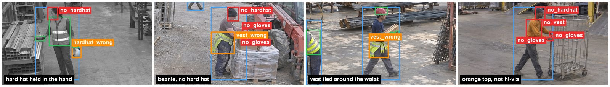

# CCTV PPE Compliance Detection Dataset: free sample (synthetic CCTV, YOLO + COCO)

**Detect PPE violations, not just PPE.** Synthetic fixed-CCTV images of workers whose hard hats, hi-vis vests and gloves are worn correctly, worn wrongly or missing, with YOLO and COCO boxes in 9 classes: 200 free images here, 1,000 in the full dataset.


**Violation types**: green boxes are PPE worn correctly, red and orange boxes are violations.



[](https://colab.research.google.com/github/Simuletic/cctv-ppe-compliance-detection-dataset/blob/main/notebooks/quickstart.ipynb) [](LICENSE) [](https://simuletic.com/datasets/cctv-ppe-compliance-detection-dataset?utm_source=github&utm_medium=readme&utm_campaign=cctv-ppe-compliance-detection-dataset)

This free sample has 200 synthetic CCTV images for **PPE detection, hard hat detection and safety vest detection**, with bounding boxes in **YOLO and COCO** format. 150 images show at least one violation and 50 show only compliant workers. Made by [Simuletic](https://simuletic.com/?utm_source=github&utm_medium=readme&utm_campaign=cctv-ppe-compliance-detection-dataset), which builds synthetic CCTV datasets for computer vision.

The sample has the same classes, label rules and folder layout as the full [CCTV PPE Compliance Detection Dataset (1,000 images)](https://simuletic.com/datasets/cctv-ppe-compliance-detection-dataset?utm_source=github&utm_medium=readme&utm_campaign=cctv-ppe-compliance-detection-dataset), so code you write for the sample runs unchanged on the full set.

## Why compliance, not presence

Most public PPE datasets label whether a hard hat or vest is in the picture, and many of their images are ground-level photos. A site camera has a different job: it looks down from a pole, wall or ceiling and has to tell whether the PPE is worn properly. This dataset labels the common ways it is not:

- a hard hat held in the hand or left on a surface, worn backwards or with the chin strap loose (`hardhat_wrong`);
- a baseball cap, beanie or hood instead of a hard hat, or a bare head (`no_hardhat`);
- a hi-vis vest worn open or tied around the waist (`vest_wrong`);
- orange or yellow clothing with no reflective stripes, which looks like hi-vis but is not (`no_vest`);
- bare hands (`no_gloves`).

Correct PPE is labelled too (`hardhat`, `vest`, `gloves`), so a model learns the difference instead of only finding hats and vests.

## At a glance

| | Free sample (this repo) | [Full dataset](https://simuletic.com/datasets/cctv-ppe-compliance-detection-dataset?utm_source=github&utm_medium=readme&utm_campaign=cctv-ppe-compliance-detection-dataset) |
|---|---|---|
| Images | 200 (162 train / 38 val) | 1,000 |
| Images with a violation | 150 (75%) | |
| Fully compliant images | 50 (25%) | |
| Night infrared (monochrome) | 46 (23%) | |
| Workers per image | 2.1 on average, up to 5 | |
| Classes | 9: `person`, `hardhat`, `hardhat_wrong`, `no_hardhat`, `vest`, `vest_wrong`, `no_vest`, `gloves`, `no_gloves` | same |
| Labels | YOLO `.txt` + COCO `.json` | same |
| Resolution | 1672×941 and 1672×940 JPEG | same |
| Licence | CC BY-NC 4.0 (non-commercial) | research ($149) or commercial ($590), one-time |

## Classes and box counts

| Class | YOLO id | What is boxed | Boxes | Images |
|---|---|---|---|---|
| `person` | 0 | every worker whose head and torso are visible | 429 | 200 |
| `hardhat` | 1 | hard hat worn correctly; box on the hat | 337 | 182 |
| `hardhat_wrong` | 2 | hard hat worn wrongly (chin strap loose, worn backwards) or not worn (held in the hand, left on a surface); box on the hat | 44 | 44 |
| `no_hardhat` | 3 | head with no hard hat: bare head, baseball cap, beanie or hood; box on the head | 68 | 67 |
| `vest` | 4 | hi-vis vest worn closed | 373 | 189 |
| `vest_wrong` | 5 | hi-vis vest worn open, or tied around the waist (then boxed at the waist) | 27 | 27 |
| `no_vest` | 6 | torso with no hi-vis vest, including orange or yellow clothing with no reflective stripes; box on the torso | 29 | 29 |
| `gloves` | 7 | gloved hand (only on workers at least about 20% of the image height) | 469 | 158 |
| `no_gloves` | 8 | bare hand (same size rule) | 236 | 98 |

Images per violation class: `hardhat_wrong` in 44, `no_hardhat` in 67, `vest_wrong` in 27, `no_vest` in 29, `no_gloves` in 98.

**Labelling rules.** Every worker whose head and torso are visible is boxed as `person`. Each worker's head gets one of `hardhat` (worn correctly), `hardhat_wrong` (worn wrongly; box on the hat) or `no_hardhat` (box on the head). A hat that is held or set down gets `hardhat_wrong` on the hat and `no_hardhat` on the bare head. Each torso gets one of `vest`, `vest_wrong` or `no_vest`. Hands get `gloves` or `no_gloves` only on workers at least about 20% of the image height; smaller workers' hands are not labelled. Boxes are axis-aligned; YOLO coordinates are normalised (0–1), COCO boxes are `[x, y, width, height]` in pixels.

## Scenes and cameras

Construction sites (the largest share), warehouses and logistics yards, and factory floors and workshops, seen from fixed CCTV cameras mounted high on poles, walls and ceilings and looking down at the workers. Lighting covers day, overcast and direct sun, dusk under floodlights, fluorescent indoor light and rain; 46 of the 200 images are monochrome night infrared.

## Folder layout

```
cctv-ppe-compliance-detection-dataset/
  data.yaml                        # Ultralytics config: class names and splits
  images/train/  images/val/       # JPEG, metadata stripped
  labels/train/  labels/val/       # YOLO: class x_center y_center width height (0-1), one .txt per image
  annotations/instances_train.json # COCO
  annotations/instances_val.json
  assets/                          # README images
  notebooks/quickstart.ipynb       # Colab: view labels, fine-tune YOLO, run inference
  quickstart.py                    # same steps as a script
```

## Quick start

**In the browser:** open the [Colab notebook](https://colab.research.google.com/github/Simuletic/cctv-ppe-compliance-detection-dataset/blob/main/notebooks/quickstart.ipynb). It loads the sample, draws the labels, fine-tunes YOLO11 for a few epochs on a free GPU and runs inference.

**On your machine:**

```bash
git clone https://github.com/Simuletic/cctv-ppe-compliance-detection-dataset
cd cctv-ppe-compliance-detection-dataset
pip install ultralytics
python quickstart.py --epochs 30 --imgsz 960
```

`quickstart.py` counts the boxes, saves label previews to `runs/label_previews/`, trains, validates and saves predictions to `runs/predict/`. Point it at the full dataset with `--data /path/to/full/data.yaml`.

**In Python:**

```python
from ultralytics import YOLO

model = YOLO("yolo11n.pt")
model.train(data="data.yaml", epochs=30, imgsz=960)
model.predict("images/val", save=True)
```

Hands and hat straps are small at CCTV distance, so train at `imgsz` 960 or higher if your GPU allows. 200 images will not give you a deployable detector. The sample is for checking the format, the camera angles and the label rules against your own footage before you buy or train on the full set.

## Use cases

- PPE compliance monitoring on construction-site, warehouse and factory CCTV
- hard hat and hi-vis vest detection that also flags wrong use (held hats, open vests, caps instead of hard hats)
- testing false alarms on orange or yellow workwear that is not hi-vis
- pre-training before fine-tuning on your own site cameras

## How the images were made

The images are fully synthetic: there are no real people, real sites or real incident footage in them. Each image was generated to a scene and camera specification (environment, camera height and angle, lighting, distance, which PPE each worker wears and how), labelled automatically, and checked before release: a vision-language model verified each box and its class, and the set was reviewed by eye. Images that failed were removed.

## Limitations

- Chin-strap and backwards-hat states can be hard to see on small, distant workers, at CCTV resolution as in real footage.
- Safety glasses, masks and hearing protection are not labelled in this version.
- Hands of workers smaller than about 20% of the image height are not labelled, as either `gloves` or `no_gloves`.
- Labels are automatic, checked by a vision-language model and reviewed visually, not drawn by hand box by box. Expect some loose or missed boxes; please report them.
- No model has been trained or benchmarked on this dataset yet, so this card makes no accuracy claims.
- Synthetic images do not cover every camera, lens, compression artefact or site you will meet in deployment. Validate on your own footage, and for production combine synthetic and real data.

## Get the full dataset

The full **[CCTV PPE Compliance Detection Dataset](https://simuletic.com/datasets/cctv-ppe-compliance-detection-dataset?utm_source=github&utm_medium=readme&utm_campaign=cctv-ppe-compliance-detection-dataset)** has 1,000 images with the same 9 classes, labels and layout, as a single download. One-time licence: **research $149** (non-commercial, one lab or course) or **commercial $590** (one organisation; models you train are yours). Need other sites, cameras or PPE classes? See [custom data](https://simuletic.com/custom-data?utm_source=github&utm_medium=readme&utm_campaign=cctv-ppe-compliance-detection-dataset).

## More synthetic CCTV datasets from Simuletic

- [CCTV Weapon Detection Dataset](https://github.com/Simuletic/cctv-weapon-dataset): free sample on GitHub · [full 1K](https://simuletic.com/datasets/cctv-weapon-detection-dataset?utm_source=github&utm_medium=readme&utm_campaign=cctv-ppe-compliance-detection-dataset)
- [CCTV Knife Detection Dataset](https://github.com/Simuletic/cctv-knife-detection-dataset): free sample on GitHub · [full 1K](https://simuletic.com/datasets/cctv-knife-detection-dataset?utm_source=github&utm_medium=readme&utm_campaign=cctv-ppe-compliance-detection-dataset)
- [CCTV Fall Detection Dataset](https://github.com/Simuletic/cctv-fall-detection-dataset): free sample on GitHub · [full 1K](https://simuletic.com/datasets/cctv-fall-incident-detection-dataset?utm_source=github&utm_medium=readme&utm_campaign=cctv-ppe-compliance-detection-dataset)
- [All datasets](https://simuletic.com/datasets?utm_source=github&utm_medium=readme&utm_campaign=cctv-ppe-compliance-detection-dataset) · [Free samples on Hugging Face](https://huggingface.co/Simuletic) · [All GitHub repos](https://github.com/Simuletic)

## Licence

The images and labels in this sample are licensed under [CC BY-NC 4.0](https://creativecommons.org/licenses/by-nc/4.0/): you may share and adapt them for non-commercial purposes with credit to Simuletic. The code (`quickstart.py`, `notebooks/`) is MIT-licensed. For commercial use, buy the [commercial licence](https://simuletic.com/datasets/cctv-ppe-compliance-detection-dataset?utm_source=github&utm_medium=readme&utm_campaign=cctv-ppe-compliance-detection-dataset). The full dataset is licensed separately.

## Citation

```bibtex
@misc{simuletic_ppe_2026,
  author       = {{Simuletic}},
  title        = {CCTV PPE Compliance Detection Dataset: synthetic CCTV images with YOLO and COCO labels},
  year         = {2026},
  publisher    = {Simuletic},
  howpublished = {\url{https://simuletic.com/datasets/cctv-ppe-compliance-detection-dataset}},
  note         = {Free sample: \url{https://github.com/Simuletic/cctv-ppe-compliance-detection-dataset}}
}
```

## Contact

Questions, bugs in the labels or custom requests: contact@simuletic.com · [simuletic.com](https://simuletic.com/contact?utm_source=github&utm_medium=readme&utm_campaign=cctv-ppe-compliance-detection-dataset) · [open an issue](https://github.com/Simuletic/cctv-ppe-compliance-detection-dataset/issues)
